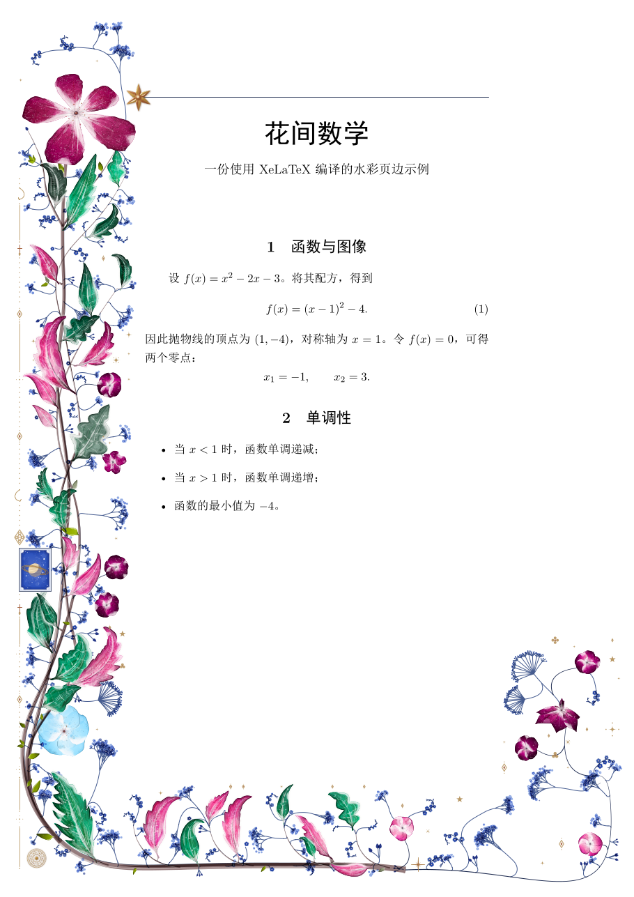

# tikz-flora-xetex

**中文 | [English](#english)**

An experimental XeLaTeX backend for [tikz-flora](https://github.com/wn-mitch/tikz-flora): procedural watercolour botanical margins generated with `texlua` and embedded as PDF page backgrounds.

`tikz-flora` 的实验性 XeLaTeX 后端：通过外部 `texlua` 生成程序化水彩植物页边，再以 PDF 页面背景嵌入文档。原 LuaLaTeX 后端仍然保留。

## Demo · 演示

以下页面均由 **XeLaTeX** 实际编译生成，示例源文件见 [`xelatex-demo.tex`](xelatex-demo.tex)。

| Left · 左侧 | Right · 右侧 |
|---|---|
|  |  |

| Centered · 双侧 | Surround · 环绕 |
|---|---|
|  |  |

## 中文说明

### 实现原理

XeLaTeX 不能直接执行 Lua，因此本 Fork 没有简单替换 `\directlua`，而是采用外部生成流程：

1. XeLaTeX 在输出页面时导出纸张、正文区域、页码和装饰参数；
2. 调用 `texlua tools/xelatex-flora.lua` 运行原有植物生成算法；
3. 生成只包含植物与装饰的单页 PDF；
4. 通过 `shipout/background` 将 PDF 嵌入正文后方；
5. 页面参数和代码未变化时复用缓存。

中文、数学公式和正文排版仍完全由 XeLaTeX 处理。

### 当前支持

- `left`、`right`、`centered`、`split`、`surround` 五种布局；
- `seed`、`mix`、`density`、`visitors`、`palette`、`colourway` 等常规设置；
- `\florasetup`、`\florathispage`、`\floraoff`、`\floraon`；
- 按页面生成和缓存 PDF；
- 原项目的 LuaLaTeX 编译路径。

### 当前限制

这是核心功能原型，并非完整等价移植：

- 植物避让整个正文区域，暂不读取每一行文字的位置；
- 暂不实现植物伸入短行、缩进和段落空白；
- 标题依赖布局 `title`、`flank`、`wreath`、`bouquet`、`scrollwork` 尚未适配；
- `\floraletters` 暂时回退为普通文字；
- `\florasheet` 和 `\floragallery` 仍需 LuaLaTeX；
- 自动调用外部程序需要 `-shell-escape`，请只对可信项目启用；
- 当前未适配 Overleaf。

### 环境要求

- XeLaTeX 和 `texlua`；
- `graphicx`、`shellesc`；
- 中文示例还需要 `ctex`、`amsmath` 和 `amssymb`。

本 Fork 已在 **Windows + MiKTeX 25.12** 上实际验证：XeLaTeX 四页示例编译成功，第二次编译全部命中缓存；原 LuaLaTeX 测试文档也可正常编译。

### 编译示例

在仓库根目录使用 Git Bash：

```bash
TEXINPUTS='./tex;' xelatex -shell-escape \
  -interaction=nonstopmode -halt-on-error xelatex-demo.tex
```

Windows 命令提示符：

```bat
set TEXINPUTS=.\tex;
xelatex -shell-escape -interaction=nonstopmode -halt-on-error xelatex-demo.tex
```

编译后得到 `xelatex-demo.pdf`。首次编译会生成植物，后续编译在参数不变时复用缓存。

### 在自己的文档中使用

将下列文件复制到文档项目，并保持目录结构：

```text
your-document.tex
tikzflora.sty
tikzflora-xetex.sty
tikzflora-boot.lua
lua/flora/...
tools/xelatex-flora.lua
```

最小示例：

```latex
\documentclass{article}
\usepackage[left=5.5cm,right=2cm]{geometry}
\usepackage{tikzflora}

\florasetup{
  layout=left,
  seed=7,
  colourway=spring,
  density=0.8
}

\begin{document}
Your text.
\end{document}
```

从包含这些文件的项目根目录运行：

```bash
xelatex -shell-escape your-document.tex
```

如需使用完整功能，请继续使用原项目的 LuaLaTeX 后端，并参考[上游完整指南](https://flora.alpacasoft.dev/guide/)。

## English

### How it works

XeLaTeX has no embedded Lua interpreter. This fork therefore keeps the original generator intact and moves it outside the TeX process:

1. XeLaTeX exports the page geometry, text block, page number and flora settings;
2. an external `texlua` process grows the plants and writes a one-page PDF;
3. the PDF is inserted into `shipout/background`;
4. unchanged pages reuse their cached PDFs.

The document text, CJK fonts and mathematics are still typeset by XeLaTeX.

### Supported features

- Layouts: `left`, `right`, `centered`, `split` and `surround`;
- Regular settings such as `seed`, `mix`, `density`, `visitors`, `palette` and `colourway`;
- `\florasetup`, `\florathispage`, `\floraoff` and `\floraon`;
- Per-page PDF generation and caching;
- The original LuaLaTeX backend.

### Current limitations

This is a working core prototype, not a feature-complete port:

- The whole text block is reserved; individual lines are not measured;
- Flora does not yet grow into short lines, indents or gaps between paragraphs;
- Title-dependent layouts (`title`, `flank`, `wreath`, `bouquet` and `scrollwork`) are not adapted yet;
- `\floraletters` falls back to plain text;
- `\florasheet` and `\floragallery` still require LuaLaTeX;
- Automatic generation requires `-shell-escape`; enable it only for trusted projects;
- Overleaf is not currently supported by the XeLaTeX backend.

### Requirements

- XeLaTeX and `texlua`;
- `graphicx` and `shellesc`;
- The Chinese demonstration additionally uses `ctex`, `amsmath` and `amssymb`.

Tested on **Windows with MiKTeX 25.12**. The four-page XeLaTeX demo compiles successfully, all pages hit the cache on the second run, and the original LuaLaTeX smoke test still passes.

### Build the demo

From the repository root in Git Bash:

```bash
TEXINPUTS='./tex;' xelatex -shell-escape \
  -interaction=nonstopmode -halt-on-error xelatex-demo.tex
```

The output is `xelatex-demo.pdf`. The first run grows the plants; later runs reuse unchanged pages.

For the complete LuaLaTeX feature set, see the [upstream guide](https://flora.alpacasoft.dev/guide/).

## Origins and credits

This is an independent experimental fork of [wn-mitch/tikz-flora](https://github.com/wn-mitch/tikz-flora). It is not endorsed by the upstream authors.

The original project credits:

- Kevin Raymond's [florilegium](https://github.com/kevinraymond/florilegium) (MIT) for grown margins, growth animation and visitors;
- the r/LaTeX discussion [How do you make these flowers in LaTeX?](https://old.reddit.com/r/LaTeX/comments/1xixznw/how_do_you_make_these_flowers_in_latex/) as the visual reference;
- [madoromi](https://madoromi.moonwit.ch/#palettes/colours) for the measured Pilot iroshizuku ink ramps;
- Wong, Zongker and Salesin, [Computer-Generated Floral Ornament](https://grail.cs.washington.edu/projects/ornament/ornament.pdf) (SIGGRAPH 1998), for the growth approach.

## License · 许可证

[MIT](LICENSE). The original copyright and permission notices are retained. The modifications in this fork are distributed under the same license.

原项目的版权与 MIT 许可声明均已保留，本 Fork 的修改也采用相同许可证发布。
